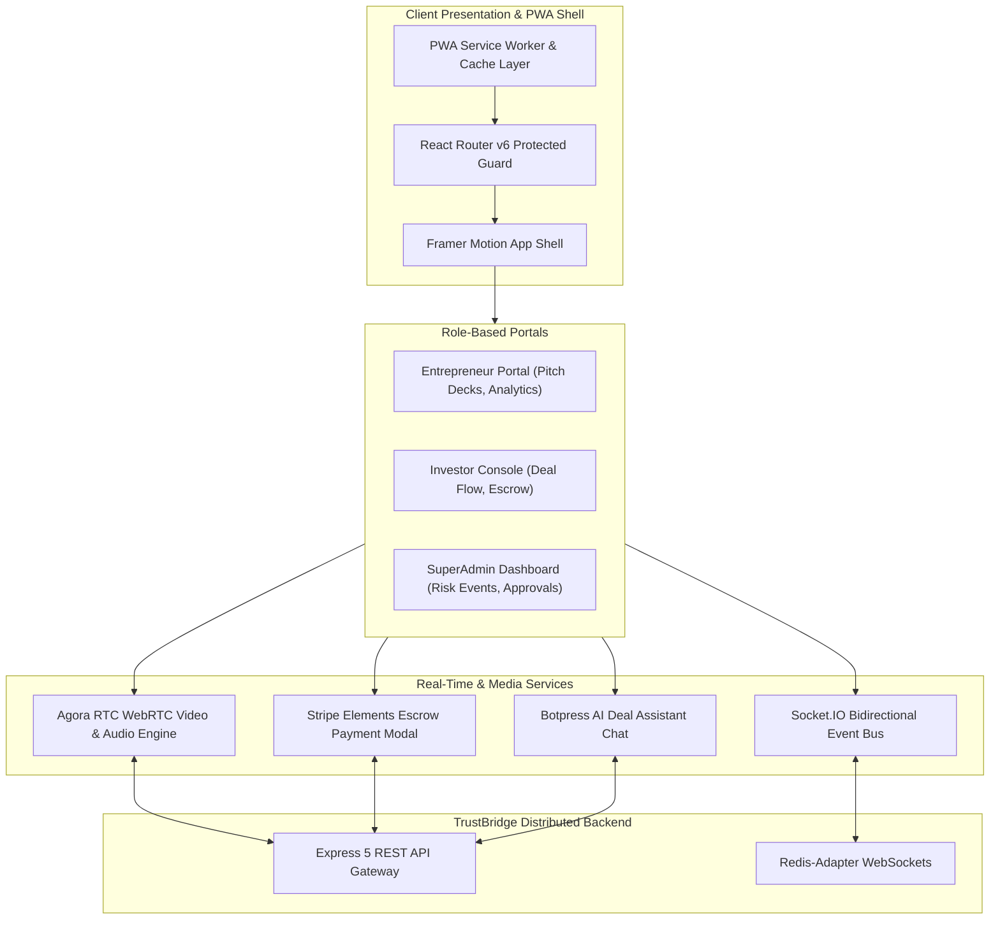

# 🚀 TrustBridge AI — Enterprise Investor Collaboration Platform (PWA)

<p align="center">
  
  
  
  
  
  
  
  
  
</p>
<br/>

> **TrustBridge AI Frontend** is an enterprise-grade Progressive Web Application (PWA) built for high-stakes startup fundraising, deal negotiations, and real-time investor collaboration. It combines WebRTC video conferencing, bidirectional Socket.IO state synchronization, and Stripe Elements checkout.

---

## 🏗️ System Architecture



---

## ⚡ Core Engineering Highlights

- **Multi-Role Portal Segmentation**: Granular role-guarded routes separating startup pitch dashboards, investor deal management, and platform administrator fraud detection.
- **Low-Latency Video Calling**: Integrated Agora WebRTC SDK (`agora-rtc-sdk-ng`) supporting camera/mic toggling, screen-sharing, and dynamic channel token expiration handling.
- **Real-Time Negotiation Synchronization**: Bidirectional Socket.IO event streams sync live deal valuation updates, document revisions, and push notification triggers with optimistic client updates.
- **Progressive Web App (PWA)**: Built with `vite-plugin-pwa` and custom service worker caching, enabling seamless offline capabilities, background notifications, and installability.
- **Production CI/CD Quality**: Enforced linting and unit testing pipelines via GitHub Actions (`nexus-ci.yml`), Husky pre-commit hooks, and Vitest test suites.

---

## 📁 Repository Structure

```text
src/
  components/
    admin/              Campaign charts, fraud detection, startup growth widgets
    ai/                 AI chat assistant and recommendation modals
    DealForm.tsx        Interactive term sheet negotiation interface
    DealPaymentModal.tsx Secure Stripe payment elements integration
  context/              Auth, WebRTC, and Socket context providers
  hooks/                Custom React hooks for Agora, WebSockets, and media streams
```

---

## 🚀 Quick Start & Local Setup

### Prerequisites
- Node.js >= 20.0.0
- npm or pnpm

### 1. Installation
```bash
git clone https://github.com/DanishAjma1/TrustBridge-AI.git
cd TrustBridge-AI
npm install
```

### 2. Environment Configuration
Create a `.env` file in the root directory:
```env
VITE_BACKEND_URL="http://localhost:5000"
VITE_AGORA_APP_ID="your-agora-app-id"
VITE_STRIPE_PUBLISHABLE_KEY="your-stripe-publishable-key"
```

### 3. Run Development Server
```bash
npm run dev
```
Visit [http://localhost:5173](http://localhost:5173) in your browser.

### 4. Run Test Suite
```bash
npm run test
```

---

## 📜 License
Distributed under the MIT License. Built with passion by [Danish Ajmal](https://github.com/DanishAjma1).
